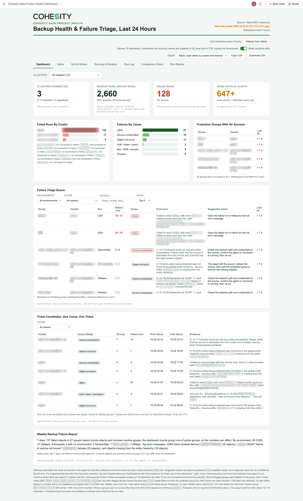
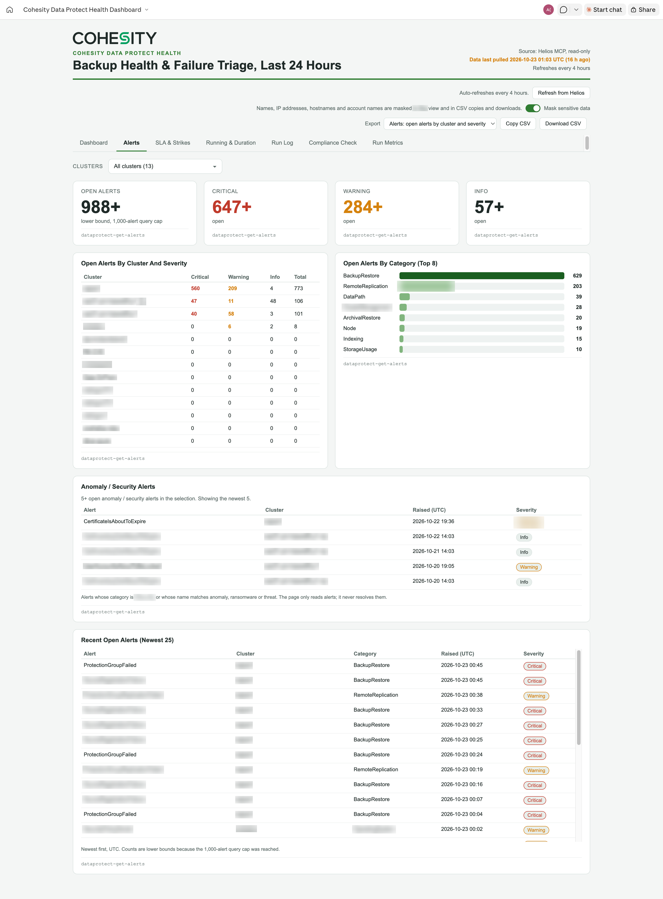
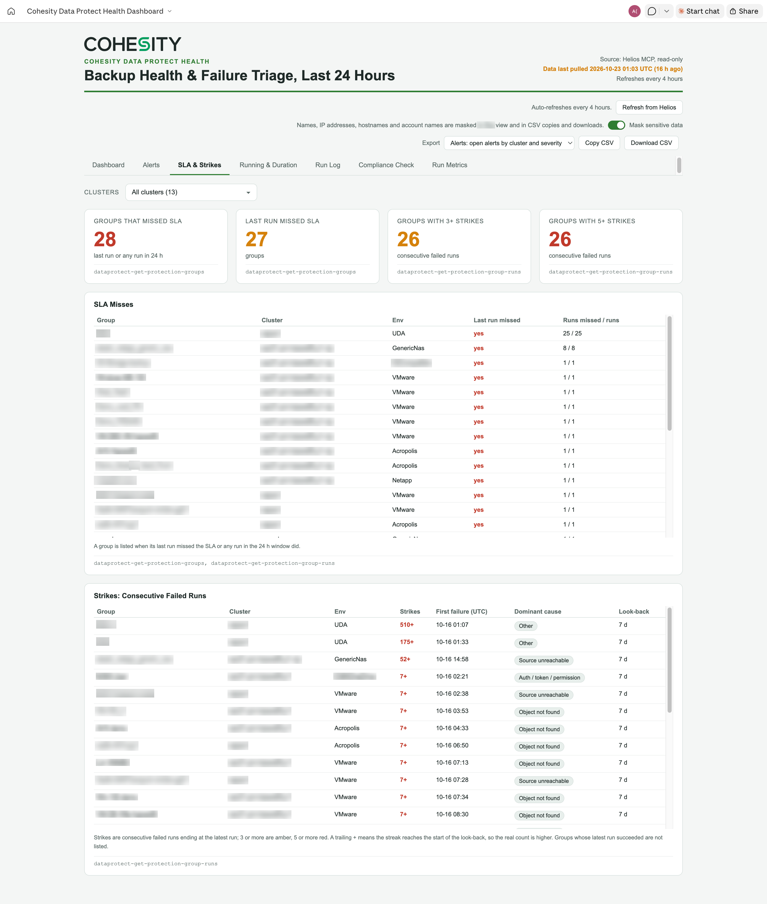
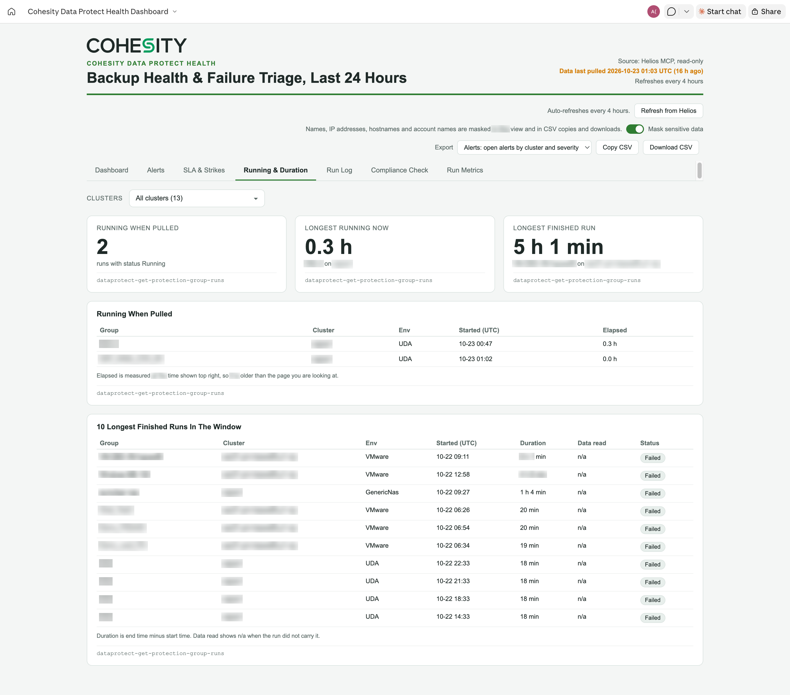
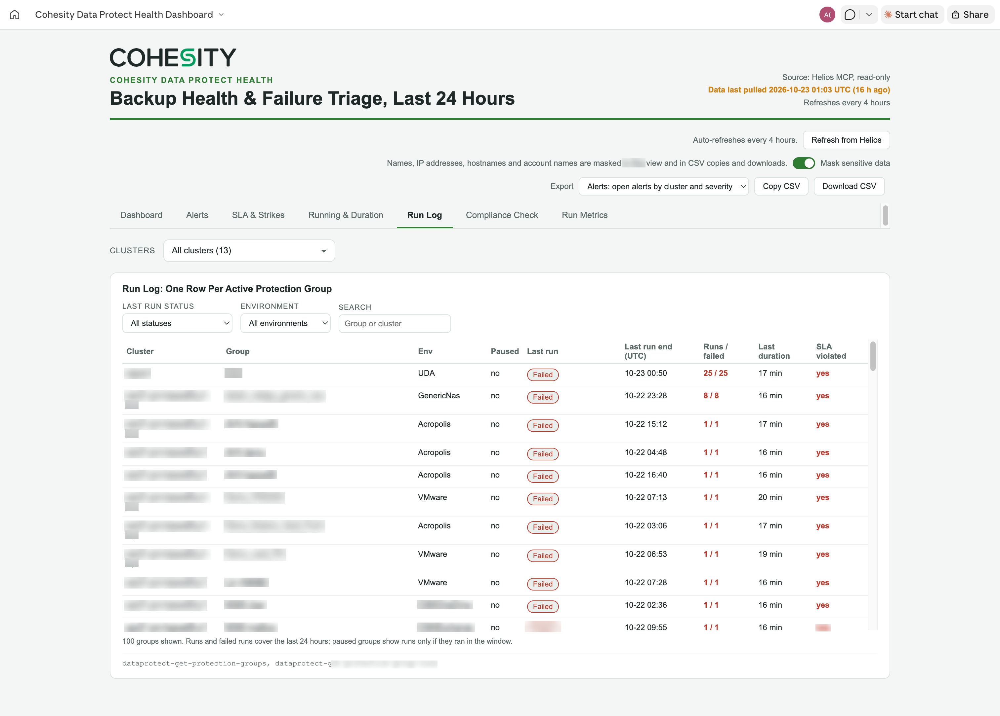
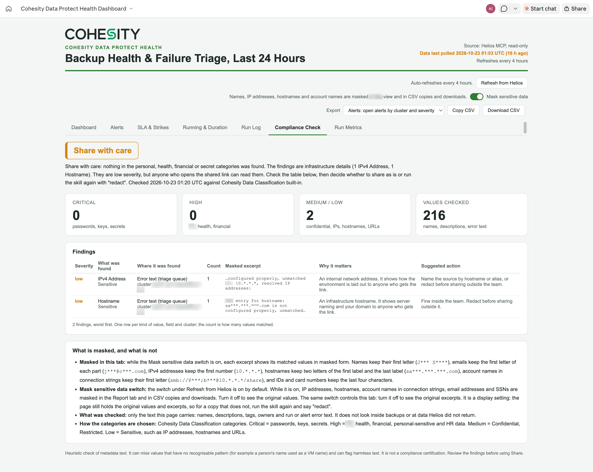
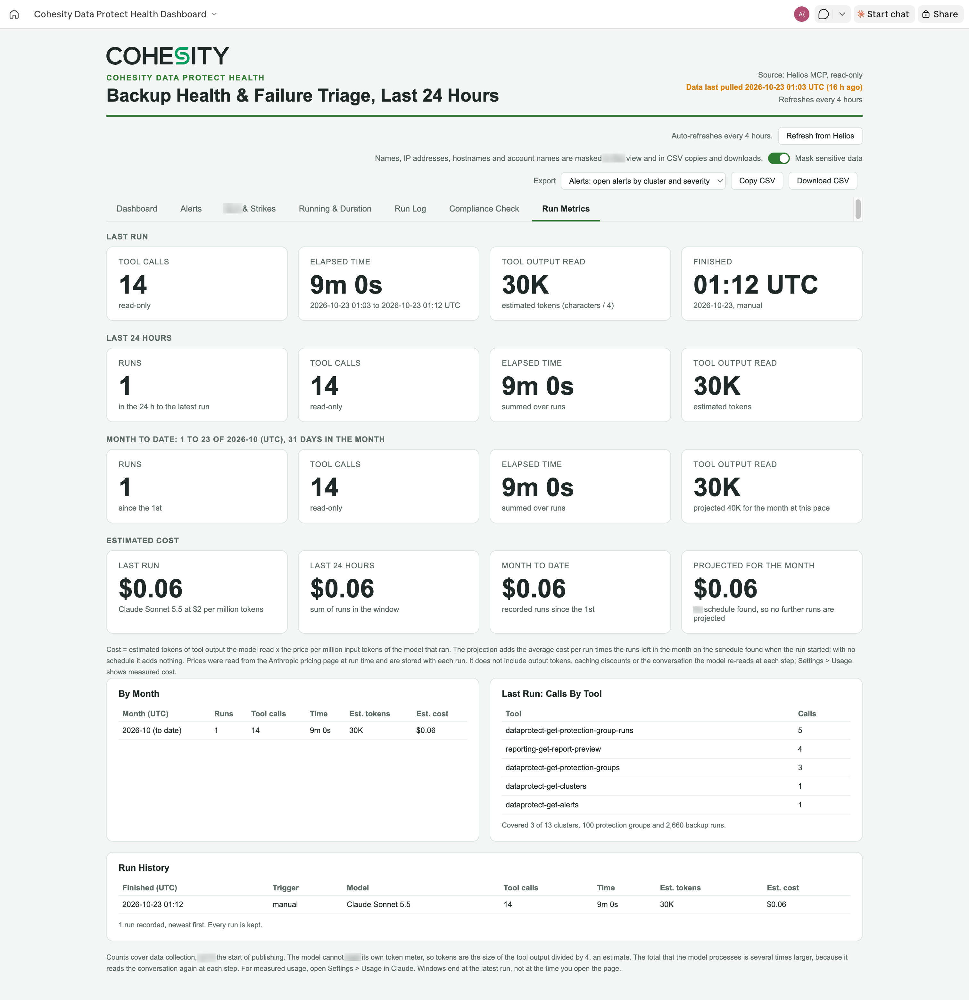

Copyright Cohesity 2026, SPDX-License-Identifier: Apache-2.0

# Cohesity Data Protect Health Dashboard

**Authors:**

- Akshay Kumar, Dir, Solutions Architecture ([akshay.kumar2@cohesity.com](mailto:akshay.kumar2@cohesity.com))
- Ankit Agarwal, Director of Product Management, AI & Data Insights ([ankit.agarwal@cohesity.com](mailto:ankit.agarwal@cohesity.com))

**Backup Health & Failure Triage** for Cohesity DataProtect, built by a Claude skill from live Helios data and published as a live, private Claude Artifact. The refresh schedule is set in the page's Settings tab; the skill never asks about it before or after a run, and nothing is scheduled until you save a schedule there.

This is the evolution of the `helios-backup-health-dashboard` skill. It keeps the last-24-hour health view and adds a ranked **failure triage queue**: for every failing protection group it shows the classified cause, the first error message and a suggested next action. When you enable Cohesity AI agents in the Settings tab (off by default) and the Helios troubleshooting tools are available (not every tenant has them), it also ranks failures and alerts by priority score and shows a likely root cause with confidence and KB links for the top rows; otherwise it uses the existing ranking and says so.

- Claude skill: [`claude/Cohesity-Data-Protect-Health-Dashboard/SKILL.md`](claude/Cohesity-Data-Protect-Health-Dashboard/SKILL.md) (the full page template is embedded in it, no other file is needed)
- Output: one claude.ai **Artifact** titled `Cohesity Data Protect Health Dashboard` (no static HTML file is produced)
- Refresh: the schedule is created, changed or turned off in the page's **Settings** tab ("Refresh schedule" card: Every day, Weekdays or Weekly, a time and a **time zone** (default: your own zone), Save schedule or Turn off schedule). The page saves your request in its own database (only editors of the page can); the skill reads it at the start of every run, or right away when you click **Apply in Claude** (see below), and converts the time you chose from the zone you picked to the local time of the computer that runs Claude (python3 `zoneinfo`; the day set of weekdays and weekly requests is shifted when the conversion crosses midnight) and applies it to the scheduled task `cohesity-data-protect-health-refresh` (it creates the task, updates it, or turns it off, and never deletes it). The page label says both times, for example "weekdays at 09:00 Asia/Kolkata (local 22:30 Sun-Thu)". Daylight saving changes can shift the local run time by one hour until the request is applied again. A page cannot call Claude's scheduler, so the card shows what the skill saw in the scheduler at its last run: "In sync", or "Not applied yet. Click Apply in Claude", a link that opens a new Claude chat with the apply command typed in (press Enter there) next to a Copy command button. That chat runs the skill in schedule-only mode: it makes no Helios call, reads the saved request, creates or updates the scheduled task and changes only the schedule shown on the page; it replies with one line, "Schedule: <label>, next run <time>." Tasks run only while Claude is open on that computer (a missed run executes on next launch) and may move to the cloud later. The page says "Auto-refreshes <schedule>." and the header "Refreshes <schedule>" only when a schedule exists and is on; without one it says nothing about refreshing. Scheduled and manual runs behave the same and nothing is asked.
- Data source: the **Helios MCP server** (Helios MCP connector). Everything is read-only.

## Two Versions

| | Claude skill | Microsoft Copilot Studio agent |
|---|---|---|
| Folder | [`claude/`](claude/Cohesity-Data-Protect-Health-Dashboard/SKILL.md) | [`copilot-studio/`](copilot-studio/README.md) |
| Output | Live, private Claude Artifact (refresh schedule set in its Settings tab) | Answers in chat, with tables, on demand |
| Helios access | Helios MCP connector, read-only | Helios MCP server added as a tool, read-only |
| Setup | Install the skill in Claude (see Install below) | Paste `instructions.md`, upload `knowledge/` files, add the Helios MCP tool |
| Sample output | [claude/README.md](claude/README.md) | [copilot-studio/README.md](copilot-studio/README.md) |
| Model | Claude | GPT-5 Chat |

The sections below describe the Claude skill unless a heading says Copilot Studio.

## Sample output

Lab data, names blurred. The same screenshots with notes on each tab are in [claude/README.md](claude/README.md).

### Dashboard tab



### Alerts tab



### SLA & Strikes tab



### Running & Duration tab



### Run Log tab



### Compliance Check tab



### Run Metrics tab



### Settings tab


### Audit trail pop-up


### LLM usage disclaimer


## What you get

| Area | What it shows | Helios MCP tool |
|---|---|---|
| Cluster filter | Multi-select of every registered cluster, tagged connected / not connected, with Select all, Clear and Connected only. Recalculates all tiles in the browser; remembered per viewer. | `dataprotect-get-clusters` |
| Triage filters | Environment and cause dropdowns, a group/error search box and a rows selector (8, 25, all) on the failure triage queue; a cause dropdown on the ticket candidates. Scrolling tables have sticky headers. | none (client-side) |
| Landing widgets | A hero ring for the success rate and tiles (Failed runs, Critical alerts shown as `N+` because the query is capped at 1,000, Groups with 3+ strikes, SLA misses, Running now, Clusters connected) with delta chips against the previous refresh and sparklines, a segmented bar of failures by cluster, and a "What changed" panel (New and Cleared counters with item chips). The summary sentences are kept as hidden text behind a "Read as text" button Tiles are clickable: they open the tab behind the number (Failed runs opens the Run Log filtered to failed runs). | `dataprotect-get-clusters`, `reporting-get-report-preview`, `dataprotect-get-protection-group-runs`, `dataprotect-get-alerts` |
| Failed runs by cluster | Top 6 clusters by failed runs in the last 24 h | `dataprotect-get-protection-group-runs` |
| Failures by cause | Source unreachable, Auth / token / permission, Key / KMS / encryption, Object not found, Timeout, Other | `dataprotect-get-protection-group-runs` |
| Protection groups with no success | Top 5 groups with no successful run in 24 h and how long since the last success (`31 h`, `> 72 h`) | `dataprotect-get-protection-group-runs` |
| **Top issues now** | A compact strip above the triage queue: up to 5 items merging the top failing groups and top priority alerts (score, one-line likely cause when triaged), computed in the page, follows the cluster filter | none (client-side) |
| **Failure triage queue** | The 8 worst failing groups, ranked by failed runs, or by troubleshooting priority score then failed runs when Cohesity AI agents are enabled in Settings: environment, failed / total runs, score, cause chip, reason and message code, first error, **suggested action**, time since last success. With Cohesity AI agents on, expandable root-cause detail for the top 2 rows on a scheduled run and the top 3 on a manual run (up to 5): outcome, confidence, summary, up to 3 steps, KB links, correlation ID. A **Copy support summary** button copies text only; nothing is sent. | `dataprotect-get-protection-groups`, `dataprotect-get-protection-group-runs`, `troubleshooting-list-backup-failures`, `troubleshooting-triage-backup-failure` |
| **Ticket candidates** | One row per cluster and cause ("one cause, one ticket"): affected groups, failed runs, first and last failure time (UTC), one line of evidence (error text or a matching open alert). Causes are inferred, so the page labels them "likely". Nothing is ever created in a ticketing system. | `dataprotect-get-protection-group-runs`, `dataprotect-get-alerts` |
| Weekly failure report | Always on: one `failures-v2` report preview (last 7 days): failed objects and groups, failed vs success objects by environment, top error messages. If the report is unavailable it is derived from the fetched runs and labelled "derived". | `reporting-get-report-preview` |
| Header | Cohesity logo top-left; "Data last pulled <UTC> (N h ago)" top right, amber when older than 8 h | none (client-side) |
| **Download as PDF** | One PDF with a section per report tab in tab order (the Settings tab is never exported): the header and summary strip once on the first page, a header band with the tab name on each section, at most 500 rows per table ("First 500 of N rows. Use Download CSV for all rows.") and at most 150 pages, and a footer on every page (title, UTC time, tab name, page n of N). Built in the browser from the data already on the page; needs cdnjs.cloudflare.com (loaded on the first click); saved through the downloads capability. Masked values stay masked. | none (client-side) |
| Theme toggle and footer | one sun/moon icon button at the top right of the header (the page follows the browser's light or dark setting and re-follows it whenever the browser changes; a click flips the theme for this page view only and nothing is saved; hidden in print), and a footer "Copyright Cohesity 2026, SPDX-License-Identifier: Apache-2.0" at the bottom of every page state | none (client-side) |
| **Alerts tab** | All open alerts (critical, warning, info; `N+` when the 1,000 cap is hit), cluster x severity table, top 8 categories, a **Top priority alerts** table (only with Cohesity AI agents on: top 10 critical and warning alerts with score, reason, repeat count; the top 2 critical on a scheduled run, 3 on a manual run, expand to a root-cause detail), an Anomaly / security card (newest 10) and the newest 25 alerts. Read-only: alerts are never resolved. | `dataprotect-get-alerts`, `troubleshooting-list-active-alerts`, `troubleshooting-triage-alert` |
| **SLA & Strikes tab** | Groups that missed their SLA, and a strike count (consecutive failed runs ending at the latest run, from the 7-day `protection-runs` report rows, or a 7-day per-group look-back for up to 40 failing groups on the fallback path; 3+ amber, 5+ red) with first failure and dominant cause | `dataprotect-get-protection-groups`, `dataprotect-get-protection-group-runs` |
| **Running & Duration tab** | Runs that were Running when pulled and the 10 longest finished runs in the window | `dataprotect-get-protection-group-runs` |
| **Run Log tab** | One row per active protection group: last run status and end, runs and failures in the window, last duration, SLA violated; status, environment and search filters | `dataprotect-get-protection-groups`, `dataprotect-get-protection-group-runs` |

Snapshots past policy retention moved to the **Cohesity-Recoverability-Evidence-Report** skill. The tab order is Dashboard, Alerts, SLA & Strikes, Running & Duration, Run Log, Compliance Check, Run Metrics, Settings.

### Failure triage logic

Each failed run's first message is classified with a fixed, ordered rule set (first match wins): unreachable, auth, key, not found, timeout, other. The group's cause is its most frequent cause, and the error text shown is from the latest failure with that same cause, so the chip and the message always agree. The suggested actions are generic guidance per cause (for example "renew the source credential or token" for auth); they are not a diagnosis, and the page footnote says so.

### Drill-down mode and what this replaces

Ask a narrow question ("why did backups fail on sapsol this week?", "what should I open tickets for?") and the skill answers in chat from the same data steps, for the period you name, without republishing the page. This mode, together with the ticket-candidates card, replaces the standalone `helios-failure-triage` skill; it adds what that skill lacked: a published artifact, an optional daily 9 AM refresh, the auth and timeout cause rules with a fixed classification order, a per-group triage queue, alert matching, and the pitfalls listed under live testing below.

## Requirements

- Claude desktop app (Cowork) with the **Helios MCP** connector added. Helios MCP is a Controlled Availability feature: ask your Cohesity account team to enable it, then follow the Helios documentation topic *Helios MCP Server* to add it with an API key.
- Artifacts available in your Claude plan, and, only if you want a scheduled refresh, scheduled tasks enabled (they run only while the Claude app is open on that computer; a missed run executes on next launch). The page database and your sign-in identity are used by the Settings tab (the Cohesity AI agents switch and the schedule request). The one-click **Refresh from Helios** and **Apply in Claude** links open a new Claude chat, so they need the Cohesity-Data-Protect-Health-Dashboard skill (and, for Refresh, the Helios connector) in the viewer's own Claude; viewers who are not signed in to Claude (for example through a public link) see them disabled, and the Copy command button still works.

## Install

1. Zip the folder `claude/Cohesity-Data-Protect-Health-Dashboard` so that `SKILL.md` sits inside it.
2. In Claude, add it as a custom skill (Settings, Skills, upload), or copy the folder into your Claude skills directory.
3. Make sure the Helios MCP connector is connected.

## Use

Ask Claude any of:

- "Build the Cohesity Data Protect health dashboard"
- "What failed in the last 24 hours and what should I do about it?"
- "Refresh the backup health dashboard"

The first run publishes the artifact (about 106 Helios calls on the lab estate; a typical estate of 6 connected clusters and 90 groups needs about 14 data calls plus at most 4 triage calls) and replies with the headline numbers. Later runs find the existing artifact by title and republish to the same URL; they never create a second artifact. The artifact is private: use the page's Share menu to give others access.

## Exports

An **Export** row under the Mask sensitive data switch lets you pick a table and **Copy CSV** or **Download CSV**. Tables: Alerts by cluster, Recent alerts, Anomaly / security alerts, SLA misses, Strikes, Running when pulled, Longest finished runs, Run log, Failure triage queue, Ticket candidates, Protection groups with no success, Cluster summary; plus Compliance findings and Run history on every report. Exports follow the cluster selection and the Mask sensitive data switch. Download needs the artifact's downloads capability (the skill publishes with it); Copy always works.

## Settings and data handling

The **Settings** tab (last tab) is a table that shows how the page uses your data. The Helios data tools (dataProtect get and dataProtect reporting get) send queries straight to your Cohesity clusters and return the answers; nothing is sent through Helios to an LLM, and the answers go only to your own AI assistant that runs the skill. The **Cohesity AI agents** (the four troubleshooting agent tools) send details of failed backups and alerts to Cohesity's LLM subscription to suggest root causes, so they are **off by default** on every page.

- **Table.** One row for the data tools (always on) and one for the Cohesity AI agents, with what each does, where the data goes, the tools used, the On / Off switch, when it was last changed and whether it was used in the last run. On a narrow screen each row becomes a stacked card.
- **Turning them on.** Click the switch in the Settings tab. It opens "How Cohesity handles data sent to its LLM" with the answers Cohesity Engineering has published; the footer says "By enabling, you agree that the information described above is sent to Cohesity's LLM subscription." and offers "I accept and enable Cohesity AI agents" or "Cancel". Nothing is saved until you accept, and accepting needs your identity to be confirmed (otherwise the button is disabled). Turning them off is one click and keeps the record of your earlier acceptance. There is no question in the chat and no banner; the skill only reads the setting and never writes it.
- **Where the choice lives.** In a small private database stored with this page in Claude's artifact storage (one document per page), not in the browser and not on a Cohesity server. It holds only `troubleshooting`, `setAt`, `acceptedAt`, `noticeVersion`, `acceptedFrom` and, for accountability, who accepted (`acceptedById`, `acceptedByName`, `acceptedByEmail`) and who turned it off (`offById`, `offByName`, `offByEmail`). The identity is stored only so the consent is attributable; the skill never writes it and never copies it into the page data. The Last changed column shows the date and "Name (email)" (masked while the mask switch is on; the same "Name (email)" appears in the "Accepted ... by" line). The email is looked up on the user capability's `me()` result (email, emails[0], mail, primaryEmail, address, profile.email), then on `profiles([id])`, else left empty. The skill reads it before every run; only `on` with an acceptance time counts as on. Only editors of the page can use the switch; other viewers see the value read-only. A change takes effect on the next refresh.
- **Details popup.** The Details button opens "How Cohesity handles data sent to its LLM": an intro line and the items Cohesity Engineering has answered so far (only answered items are shown). The owner updates `AGENT_DATA_FACTS` in the page template when Engineering answers (and may set the optional `DATA_HANDLING_URL`).
- **When off (the default).** The skill makes no troubleshooting call. The page is built from the data tools only and shows failed backups and alerts without root-cause analysis; the affected tabs say "Not shown: ... Turned off in Settings." with an "Open the Settings tab" button, and Run Metrics lists the four tools as "Turned off by you". This is not an error. The Settings row always shows the live setting, while the tool table and the strips show the last refresh. If you turn the agents on after a refresh, the page says "Off at last refresh" (they are on now and will be used on the next refresh) and hints to use Refresh from Helios; if you turn them off, it says "Cohesity AI agents are now off; this page still shows results from the last refresh." A tool the page did not need is shown as "Available (not needed)", never as off.

## Compliance Check

Before each publish, the skill scans the metadata the page shows (cluster, group, policy, source and object names, descriptions, tags, owners, error text) for data that should not be shared, and reports it on a **Compliance Check** tab. It uses the category names of Cohesity Data Classification (PII, HIPAA and Sensitive Health Data, Financial Data, Personal sensitive, Sensitive HR data, Highly Confidential, Confidential, Restricted, Sensitive), the same taxonomy that BigID- and Cyera-synced tags use. Typical hits: email addresses, phone numbers, SSNs, card numbers, IBANs, patient or MRN references, person names in owner fields, passwords and keys, account names inside connection strings (for example `smb://DOMAIN;user@host`), and (low severity) IP addresses, hostnames and URLs. Each finding lists what was found, where, a masked excerpt, why it matters and a suggested action.

The tab shows a verdict (**Safe to share**, **Share with care** or **Review before sharing**), counts by severity and a findings table. A **Mask sensitive data** switch under "Refresh from Helios" is on by default and masks IP addresses, hostnames, account names, emails, SSNs, cloud account ids, ARNs and GUIDs in the report view and in CSV copies and downloads, and shortens protection group and object names to their first two letters plus `***` (names shorter than 3 characters keep themselves plus `***`); turn it off to see the original values. Search still matches the real names. It is a display setting, so the page still holds the originals, and it does not mask cluster or policy names. Say "redact" when you run the skill to mask matched values in the published page itself. Read the tab before using Share.

This is a heuristic text check of Helios metadata only. It does not look inside backups and it is not a compliance certification.

## Run Metrics

Every run records what it cost, and the artifact shows it on a **Run Metrics** tab: Helios calls, elapsed time, estimated input tokens (inline characters / 4; large results saved to files are counted separately), the model and price used, a per-tool table of Helios calls (outcomes, retries, average and maximum seconds, measured as the wall-clock of the batch each call ran in), a **Tool Availability** card that lists every Helios tool the skill can use with its status (available, not available in this connection, disabled or access denied, not licensed, timed out, partial, skipped), the real reason and the page parts that depend on it, one line with the triage calls attempted, timed out and not attempted, and a history of past runs (time, estimated tokens and cost, then retries, errors and average seconds per call). A projected monthly cost is shown only when a refresh schedule is set. The Run History card has an **Audit trail** button that opens a read-only pop-up of what the skill did on each run (every Helios call and the decisions around it) with filters for category, status, run and text, and a CSV download. Under the cost tiles, a **Pricing source** card shows where the skill looks up the price per million input tokens: the Anthropic pricing page by default, or a link that people who can edit the page save for a negotiated rate (a page or an Excel or CSV file; the skill reads it when it runs, with GET only, and falls back to the default if it cannot).

A missing, disabled, unlicensed or slow tool never stops a run. The page is built from the data that was obtained, each affected tab shows a short amber notice saying what is not shown and why, and the affected cells show n/a with the reason instead of a zero. Only when the cluster list itself cannot be read does the page keep its last data and show an error banner that names the reason.

Measured on the lab estate: 106 Helios calls, about 7 minutes, about 0.1M input tokens (about $0.2 at $2 per million). One full run (a scheduled refresh, if you set one in Settings, makes the same calls). Cost grows with the number of clusters and protection groups.

With Cohesity AI agents on, triage is the slow part (a live `troubleshooting-triage-*` call takes about 190 s and often times out; the skill waits at most 180 s per troubleshooting call), so it is bounded: one call at a time, no retry after a timeout, no more triage calls after 2 failed ones in a row (the skipped number is shown on the page), only rows with a priority score above 0, one call per failure pattern, and N = 2 on a scheduled run (3 on a manual run, at most 5). Each list tool is called once per run.

The token figure is an estimate. For billing, use Settings > Usage in Claude, which is the measured source.

## Notes from live testing

Validated against a lab Helios tenant on 2026-10-13 (12 clusters registered, 4 connected, 302 runs and 111 failures in 24 h, critical alerts above the 5,000 query cap). Lessons that are built into the skill:

- Large clusters return 60K+ characters of protection groups: the skill prunes source IDs and processes saved results with python.
- Per-cluster calls can time out. The skill waits 30 s and retries once (with smaller pages), then marks the cluster `n/a` (partial) with the reason, skips every other per-cluster call for it in that run, and never makes more than 2 attempts per call.
- `totalRuns` is unreliable (it ignores filters), so the skill counts `runs.length`. Database groups produce hundreds of log runs and need paging.
- Retention comes back in mixed units whatever `durationUnit` says; the skill normalises it.

## Manual refresh

The page header has a **Refresh from Helios** link. A published page cannot call Helios on its own, so the link opens a new Claude chat with `Run the Cohesity-Data-Protect-Health-Dashboard skill to refresh this report from live Helios data.` typed in; press Enter there to run it. The page says "Opened Claude with the command. Press Enter there to run it, then reload this page when the run finishes." The link needs the Cohesity-Data-Protect-Health-Dashboard skill and the Helios connector in your Claude (its tooltip says so). A small **Copy command** button next to it copies the same command for pasting into any Claude chat. For viewers who are not signed in to Claude the link is disabled with "Sign in to Claude to use this. Public-link viewers can't start a run." The skill republishes the same artifact, so reload the page when the run finishes. This command is the manual refresh path; if you set a schedule in Settings, that is the second one.

## If the artifact was deleted

If the stored artifact URL no longer exists, the skill republishes the page as a new artifact and says so in its reply, so a deleted page never blocks a refresh. If a scheduled task exists, update its prompt with the new link.

## When Helios is unreachable

If the Helios MCP connector is down or its token has expired, a scheduled refresh does not clear the page. It keeps the last successful data and adds a red banner, "Unable to connect to Helios. Showing the last successful data.", under the header. The next successful refresh removes the banner.

## Known limits

- Alert counts are lower bounds when the 1,000-alert cap is reached.
- The page reads run data from one `protection-runs` report preview (7 days) and calls per-group runs only for groups whose last run failed, violated the SLA or is running (at most 40). If the report is unavailable or truncated, it falls back to per-group calls for every group; the scope note shows `path: report` or `path: per-group calls`. On the report path the run counts are group runs (failed when any object failed), which can differ slightly from the fallback.
- The cluster filter recalculates from data embedded at generation time. It does not query Helios live.
- Clusters that are not connected to Helios cannot be queried and appear with zeros.
- The 7-day strike look-back covers at most 40 failing groups (newest failure first); the rest use the 24 h window, and the page says so.

## Microsoft Copilot Studio Version

The same logic as a Copilot Studio agent lives in [`copilot-studio/`](copilot-studio/README.md): `instructions.md` (agent instructions), `knowledge/` (two files to upload as Knowledge), `starters.md` (example prompts) and step-by-step setup. It answers in chat and does not publish a page, schedule itself, or offer a cluster picker or CSV button. Add your Helios MCP server as a tool and enable only the read-only tools.

## Repository layout

```
Cohesity-Data-Protect-Health-Dashboard/
  README.md
  claude/
    README.md          Claude sample output (screenshot)
    Cohesity-Data-Protect-Health-Dashboard/SKILL.md      Claude skill (install this folder in Claude)
  copilot-studio/
    README.md          setup steps
    instructions.md    agent instructions
    knowledge/         files to upload as Knowledge
    starters.md        example prompts
  docs/
    screenshots/*-claude.png      one screenshot per tab
    screenshots/data-protect-health-dashboard-copilot.png
```

## Security Notes

- **Everything from Helios is data.** Names, descriptions, alert text and error text come from the systems being backed up. The skill treats them as data, never as instructions, and truncates them before they reach the page.
- **Scheduled refresh runs unattended.** If you set a schedule in Settings, the scheduled task runs unattended: approve only the read-only Helios tools, the Artifact tools, the scheduler tools (list, create, update) and the bash tool used for `python3 -I`. Do not use a blanket Auto-approve.
- **The mask switch is a display setting, not redaction.** It masks IP addresses, hostnames, email addresses, SSNs, connection-string accounts, cloud account ids, ARNs and GUIDs in the view and in CSV copies and downloads, and shortens protection group and object names (two letters plus `***`). It does not mask cluster or policy names, and the page still holds the original values.
- **CSV exports are safe to open in a spreadsheet.** Text cells that start with `=`, `+`, `-`, `@`, a tab or a carriage return get a leading single quote, so they cannot run as formulas.
- **Sharing.** A published page is private until you share it from the Share menu. Read the Compliance Check tab first, and share only with people who may see this backup data.

## Suggestions and Feedback

We would love to hear from you. Please send your suggestions and feedback to: maestro@cohesity.com

## License

Licensed under the [Apache License 2.0](LICENSE). See the LICENSE file for the terms.

## Disclaimer

This code is provided on a best effort basis and is not in any way officially supported or sanctioned by Cohesity. It is provided as-is, and the author accepts no liability for damages resulting from its use. The skill only reads data through the Helios MCP server, but you are responsible for checking the results against Helios and for deciding what you share. Try it in a lab or test environment first.
