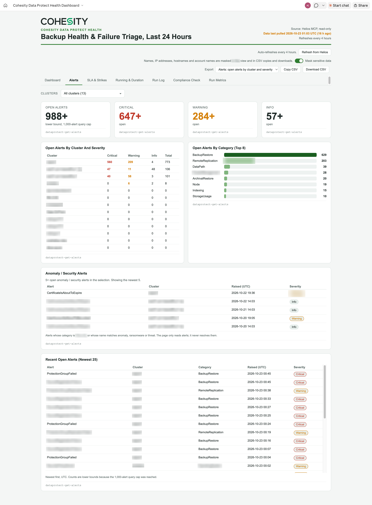
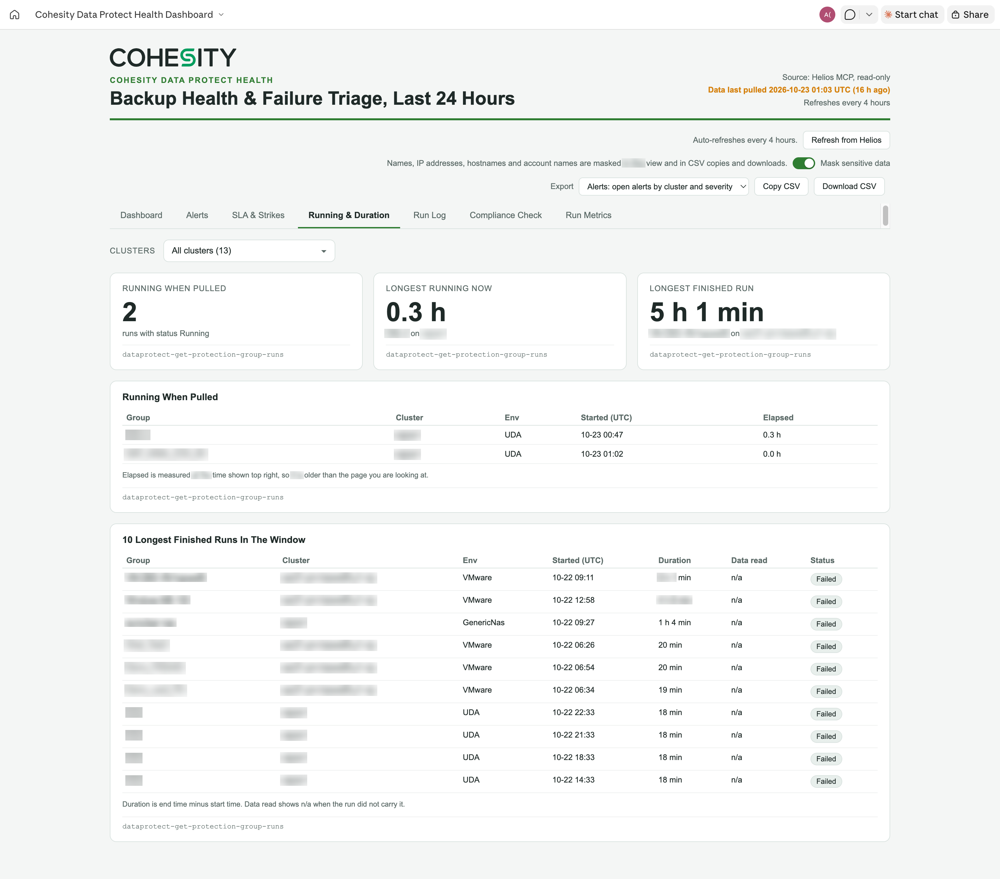
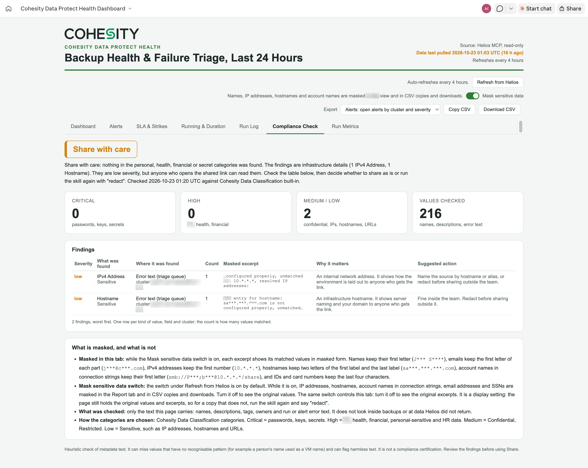
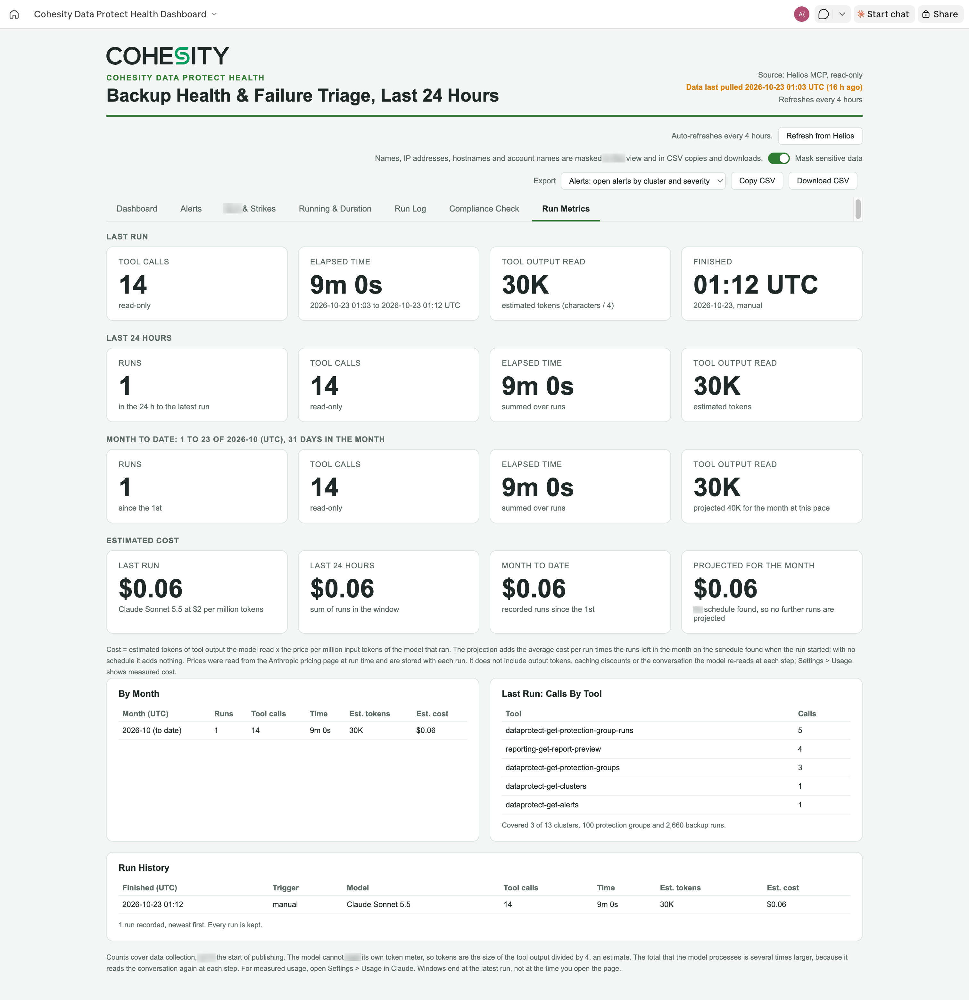

# Data Protect Health: Claude Sample Output

Sample output of the Claude skill [`Cohesity-Data-Protect-Health-Dashboard/SKILL.md`](Cohesity-Data-Protect-Health-Dashboard/SKILL.md). For install and use, see the [main README](../README.md). Every page has the Cohesity logo top-left and "Data last pulled" with its age top-right. Screenshots are from the published artifact; cluster and group names are lab data.

## Dashboard

## Alerts

Open alerts by cluster and severity.

## SLA & Strikes

Groups that missed their SLA and groups with consecutive failed runs.

## Running & Duration

Runs in progress and the longest runs.

## Run Log

One row per active protection group with its last run.

## Compliance Check

Checks the metadata shown on the page for personal data, secrets and infrastructure details before the page is shared.

## Run Metrics

Tool calls, elapsed time, estimated tokens and estimated cost for the last run, the last 24 hours and the month to date, plus the full run history.

