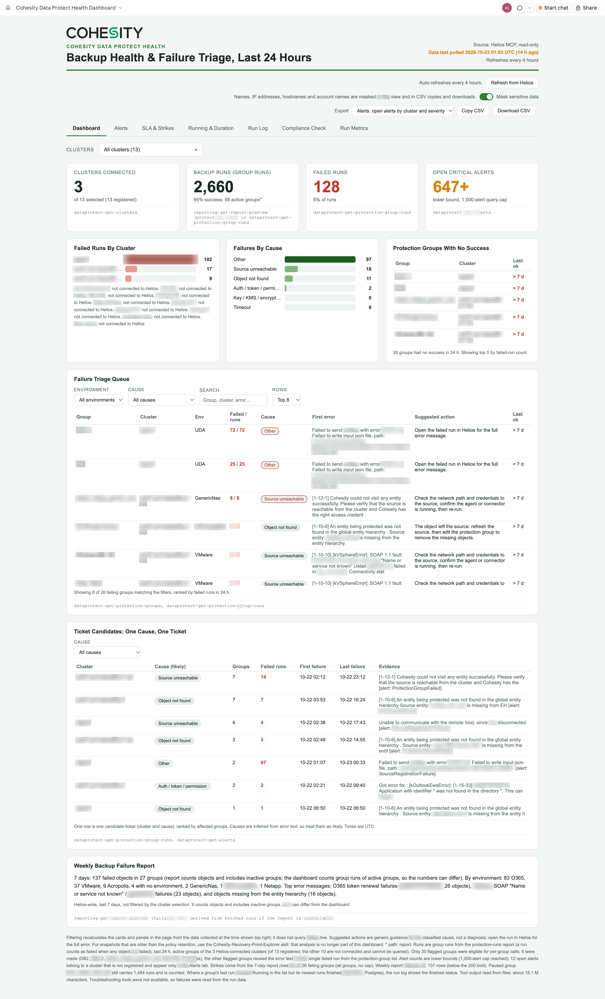
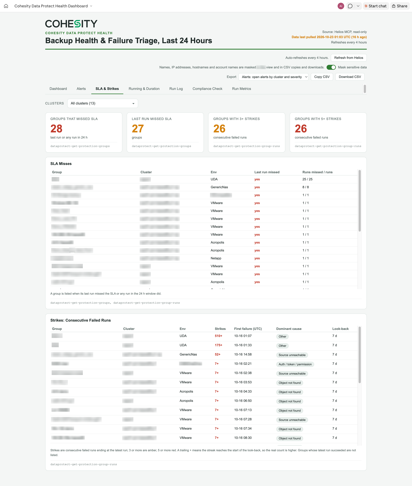
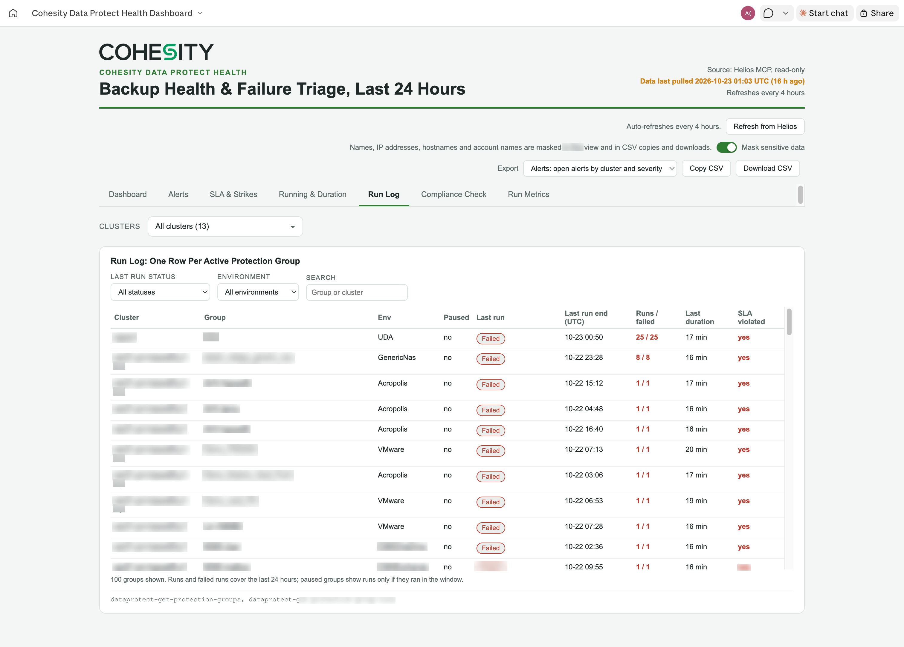
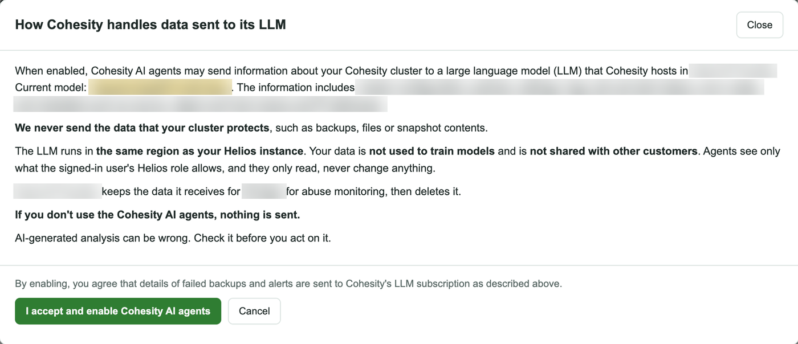

Copyright Cohesity 2026, SPDX-License-Identifier: Apache-2.0

# Data Protect Health: Claude Sample Output

Sample output of the Claude skill [`Cohesity-Data-Protect-Health-Dashboard/SKILL.md`](Cohesity-Data-Protect-Health-Dashboard/SKILL.md). For install and use, see the [main README](../README.md). Every page has the Cohesity logo top-left and "Data last pulled" with its age top-right. Screenshots are from the published artifact (lab data); hostnames, cluster names and other identifying values are blurred.

## Dashboard

## Alerts

Open alerts by cluster and severity.

## SLA & Strikes

Groups that missed their SLA and groups with consecutive failed runs.

## Running & Duration

Runs in progress and the longest runs.

## Run Log

One row per active protection group with its last run.

## New in this version

- **Landing widgets**: a hero ring for the success rate and tiles for failed runs, critical alerts, groups with 3+ strikes, SLA misses, running now and clusters connected, with delta chips and sparklines, a segmented "Failures by cluster" bar and a "Read as text" button for the summary sentences (included in the PDF as a Summary card). The tiles are clickable and open the matching tab (Failed runs opens the Run Log filtered to failed runs).
- **What changed** (New and Cleared counters with item chips, "+N more" to expand, plus number chips with arrows and the words good or bad). The first refresh after an upgrade shows "First snapshot saved."
- **Needs Attention Today**: every failing group (up to 200), shown 5 or 10 per page with Previous and Next buttons, SLA misses and critical alerts, ranked by strikes x 3 + SLA miss x 2 + critical alert x 2 + failed in the window. Hints such as "See Cohesity-Recoverability-Evidence-Report" are plain text unless the owner fills `SIBLING_URLS` in the template.
- **Trend sparklines** on the Failed runs and Critical alerts tiles (from 3 refreshes on; the page keeps up to 30 daily points).
- **Download as PDF** button: builds a real PDF of every report tab (one section per tab in tab order, header and summary strip once on the first page, a header band with the tab name, at most 500 rows per table and 150 pages, the Settings tab never exported) in the browser from the data already on the page (nothing is sent anywhere; needs cdnjs.cloudflare.com for the PDF libraries, loaded on the first click). It is saved through the downloads capability, which asks you to confirm.
- **Footnote for hand-typed figures** when the run had to transcribe inline tool output.
- Masking now also covers 12-digit cloud account ids, AWS ARNs and Azure subscription or tenant GUIDs, and the Compliance Check lists them as Low (Sensitive).
- **Names while the mask is on.** Protection group and object names are shown as their first two letters plus `***` everywhere (tables, lists, tooltips, `aria-label`, CSV, PDF, copied summaries); search, sorting and the What Changed comparison keep using the real names, and cluster and policy names stay readable. The skill may list object names that appear inside the text it writes in `objs`.
- **Time zone in the schedule card.** The Settings schedule card has a Time zone select (default: your zone). The request saves `tz`; the skill converts the time to the computer's local zone with python3 `zoneinfo`, shifts the weekday set when the conversion crosses midnight and records the machine zone as `meter.schedule.tz`. Daylight saving changes can shift the local run time by one hour.
- The Settings tab is the shared canonical block v1.4 (tab id `tabset`). None of this adds Helios calls.
- **One-click links.** **Refresh from Helios** (page header) and **Apply in Claude** (Settings, Refresh schedule card) open a new Claude chat with the command typed in; press Enter there. They need the Cohesity-Data-Protect-Health-Dashboard skill (Refresh also the Helios connector) in your own Claude, and are disabled for viewers who are not signed in to Claude (Copy command still works). Apply runs the skill in schedule-only mode: no Helios call, it applies the saved schedule request and changes only the schedule on the page.

## Settings

The last tab is a table that explains how the page uses your data: the data tools query your clusters directly and send nothing through Helios to an LLM, and the **Cohesity AI agents** (the four troubleshooting agent tools, which send failed-backup and alert details to Cohesity's LLM subscription) are **off by default**. Turning the switch on opens a popup with the answers Cohesity Engineering has published about the data sent to its LLM; nothing is saved until you click "I accept and enable Cohesity AI agents", which also records who accepted (id, name and email, kept only for accountability; the skill never writes or copies it into the page data) and is disabled when your identity cannot be confirmed. The **Details** button opens the same popup read-only. The choice is kept in a small private database stored with this page in Claude's artifact storage (not in the browser, not on a Cohesity server), applies to this page only and takes effect on the next refresh. The skill only reads it, never writes it and never asks in the chat. With the agents off the page is built from the data tools only. The Settings row always shows the live setting, while the tool table and the strips show the last refresh. If you turn the agents on after a refresh, the page says "Off at last refresh" (they are on now and will be used on the next refresh) and hints to use Refresh from Helios; if you turn them off, it says "Cohesity AI agents are now off; this page still shows results from the last refresh." A tool the page did not need is shown as "Available (not needed)", never as off.

## Compliance Check

Checks the metadata shown on the page for personal data, secrets and infrastructure details before the page is shared.

## Run Metrics

Tool calls, elapsed time, estimated tokens and estimated cost for the last run, the last 24 hours and the month to date, plus the full run history. An **Audit trail** button in the Run History card opens a filterable, read-only list of every Helios call and decision the skill made, and a **Pricing source** card lets editors replace the default Anthropic pricing page with their own price list link.

## Settings

The Settings tab is the same on every Cohesity skill page. It lists what the page reads, where the data goes, and the one switch for the optional Cohesity AI agents (off by default), plus the **Refresh schedule** card.

## Audit trail

The **Audit trail** button in the Run Metrics tab (Run History card) opens a read-only list of every Helios call and decision of each run, with filters for category, status, run and search, and a CSV download.

## How Cohesity handles data sent to its LLM

Before the Cohesity AI agents can be switched on, the page shows this notice. The questions and answers are blurred in this sample; the page shows them in full.

